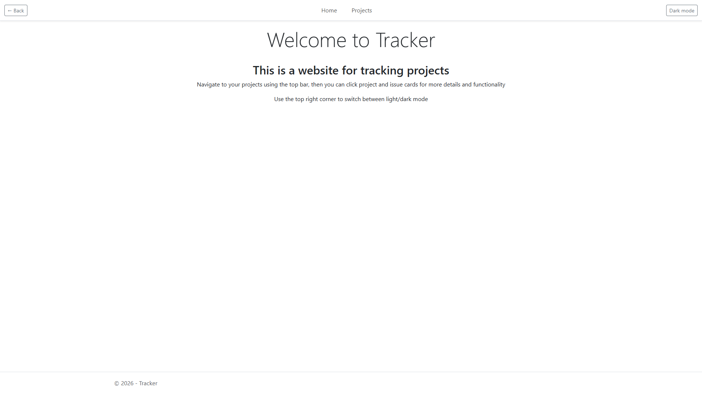
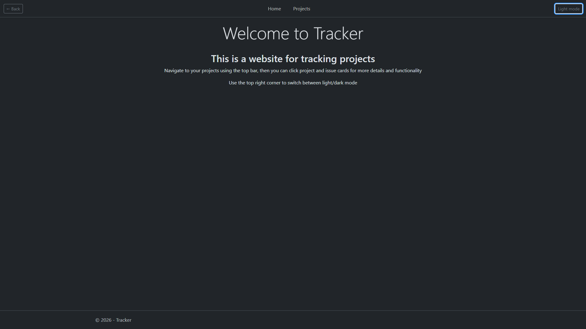
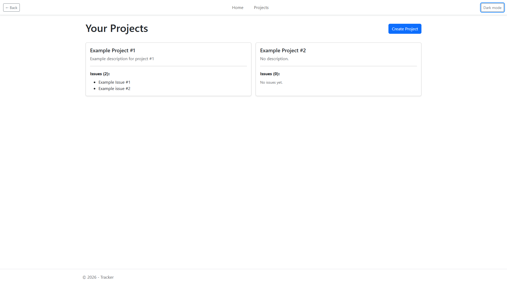
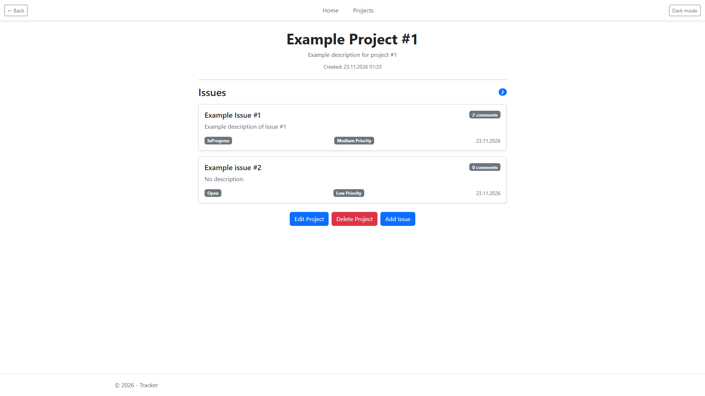
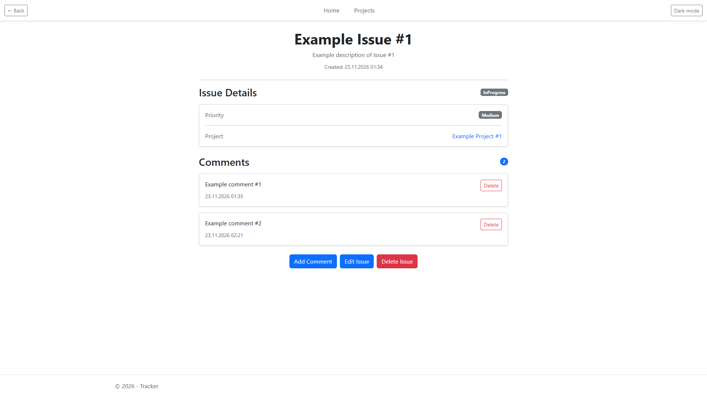
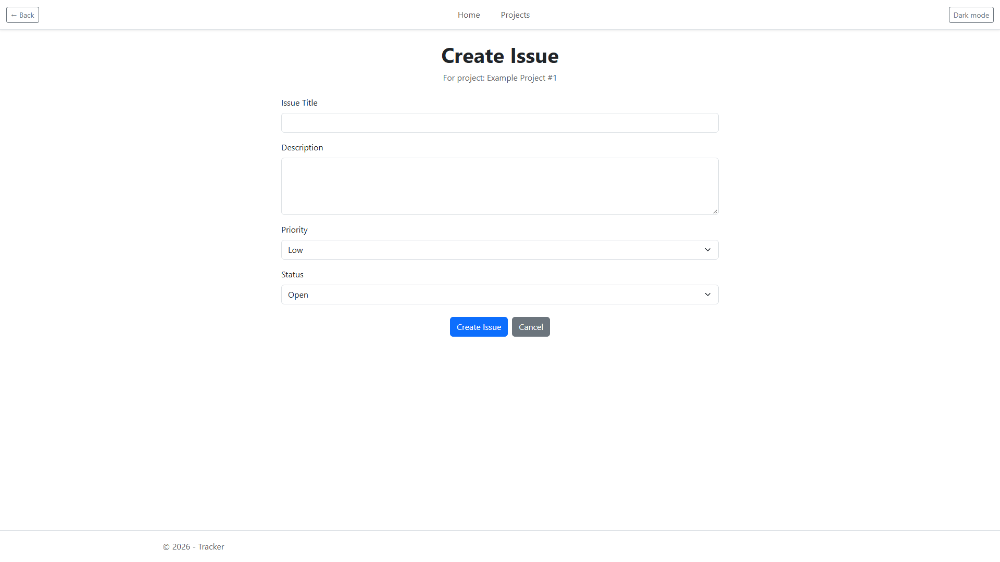
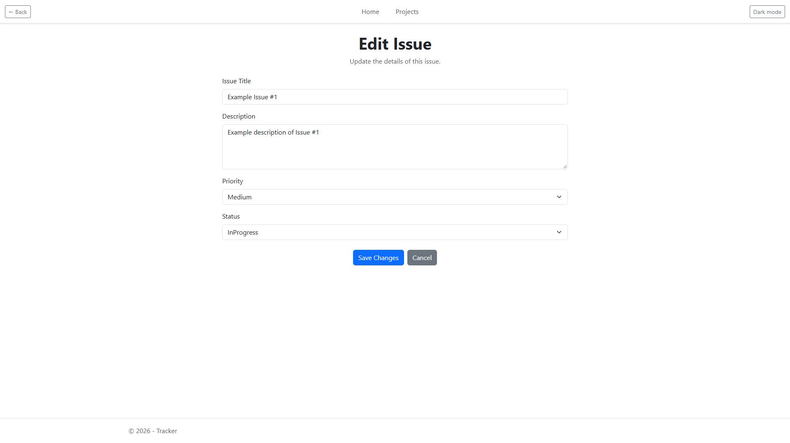
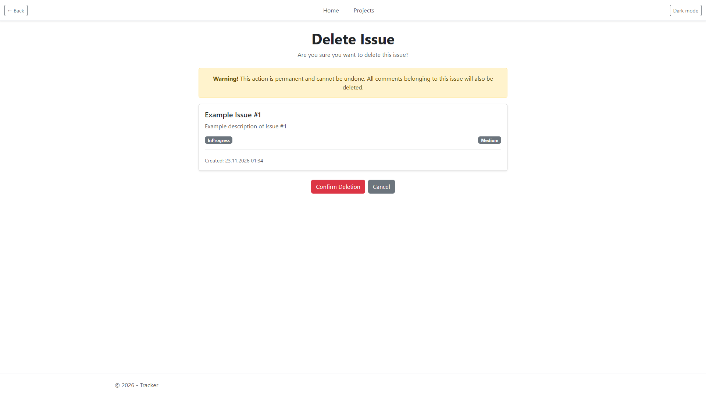

# Tracker – Project & Issue Tracker

A simple application for tracking project and issues built with **ASP.NET Core MVC**, allowing users to organize projects, manage issues, and keep track of comments.
[Screenshots of the app can be seen here](#Screenshots)

## Features

- **Project Management** – Create, view, edit, and delete projects.
- **Issue Management** – Create, view, edit, and delete issues within projects.
- **Priority Levels** – Assign Low, Medium, or High priority to issues.
- **Issue Statuses** – Track issues as Open, In Progress, or Closed.
- **Comments** – Add and delete comments on individual issues.
- **Data Persistence** – Store application data using SQLite.

## Technologies Used

- C#
- ASP.NET Core MVC
- Entity Framework Core
- SQLite
- Bootstrap 5
- Razor Views
- HTML / CSS

## Database

The application uses Entity Framework Core with SQLite for data persistence.

Database relationships:
- A Project can have multiple Issues.
- An Issue belongs to one Project.
- An Issue can have multiple Comments.
- A Comment belongs to one Issue.

EF Core migrations are included in the repository to manage database schema changes.

### Installation

- required [.NET SDK](https://dotnet.microsoft.com/download)

1. Clone the repository:

   ```bash
   git clone https://github.com/PaftDunk22/Tracker.git
   ```

2. Navigate to the project directory:

   ```bash
   cd Tracker
   ```

3. Apply database migrations:

   ```bash
   dotnet ef database update
   ```

4. Run the application:

   ```bash
   dotnet run
   ```

The application will be available at the local address displayed in the terminal.

## Screenshots
This is the home page


This is the dark mode function, available for every page on the site


This is the projects page


This is the project detail page


This is the issue page


This is an example of a create page


This is an example of an edit page


This is an example of a delete page

